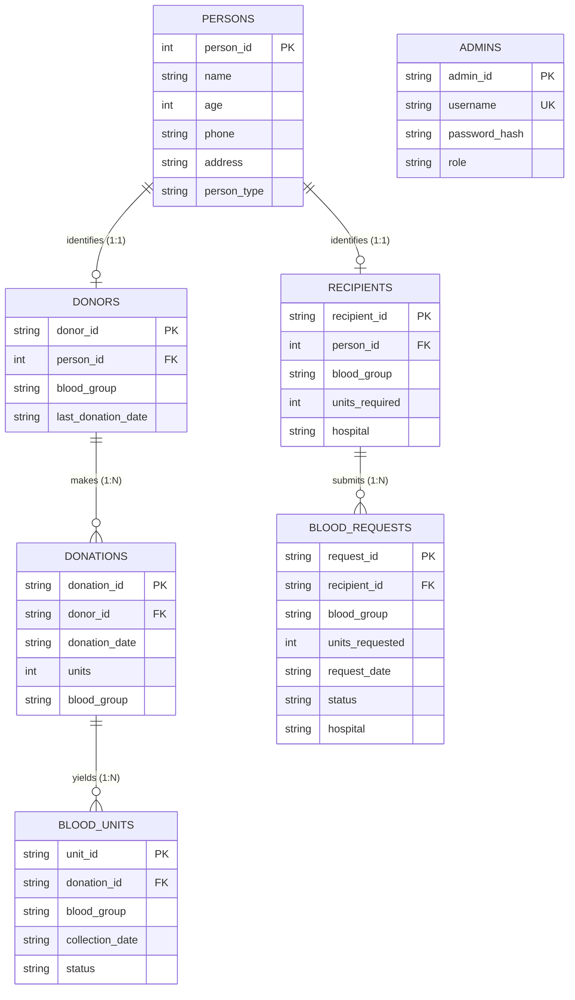

# BLOOD DONATION MANAGEMENT SYSTEM
**Academic Object-Oriented Programming (OOP) Desktop Application**

[](https://www.oracle.com/java/)
[](https://www.formdev.com/flatlaf/)
[](https://www.sqlite.org/)
[]()

---

## 1. Project Objective

The **Blood Donation Management System** is a full-featured, production-ready Windows desktop application created as an academic demonstration of core **Object-Oriented Programming (OOP)** concepts, layered architecture, and relational database persistence using SQLite and JDBC.

It provides a complete medical operations platform for blood banks and hospitals to register donors, record blood donations, manage real-time inventory for all 8 standard blood groups, fulfill recipient blood requests with automated inventory deduction, enforce clinical validation rules, and export analytical reports.

---

## 2. Key Features

- 🔐 **Administrative Authentication**:
  - Secure login portal with password hashing (SHA-256).
  - Default credentials pre-configured (`admin` / `admin123`).
  - Account management and password modification.
  - Session control with seamless Logout and Exit routines.

- 📊 **Executive Dashboard**:
  - 6 Real-time KPI Metric Cards:
    1. Total Donors
    2. Total Recipients
    3. Total Donations
    4. Available Blood Units
    5. Pending Blood Requests
    6. Low Stock Blood Groups
  - Live stock snapshot across all 8 blood groups (`A+`, `A-`, `B+`, `B-`, `AB+`, `AB-`, `O+`, `O-`).
  - Quick action launchers for fast demonstration.

- 🩸 **Donor Management (Full CRUD & Search)**:
  - Register new donors with full medical and contact details.
  - Search donors by Donor ID, Name, or Blood Group.
  - Update donor records and delete donors (with foreign key cascade handling).
  - Live field validation (eligibility age 18–65, valid 10-digit phone, duplicate ID prevention).

- 📋 **Recipient Management (Full CRUD & Search)**:
  - Register recipients with patient name, age, phone, address, and hospital name.
  - Record required units and target blood group.
  - Search recipients by ID, Name, or Hospital.

- 📦 **Blood Inventory Control**:
  - Real-time stock counts for all 8 standard blood groups.
  - **Dynamic Stock Level Calculation**:
    - `0 units` $\rightarrow$ **OUT OF STOCK** (Red warning)
    - `1 - 3 units` $\rightarrow$ **LOW STOCK** (Amber warning)
    - `4+ units` $\rightarrow$ **AVAILABLE** (Green status)
  - Detailed individual blood unit records (Unit ID, Blood Group, Collection Date, Status, Donation ID).
  - Ability to manually inspect and mark units as `AVAILABLE` or `EXPIRED`.

- 🔍 **Blood Search & Request Issuing**:
  - Search blood availability by group before requesting.
  - Instant stock verification with visual cards.
  - **Strict Stock Validation**: If requested units > available stock, issue is strictly blocked with a clear warning: `Insufficient stock for [Group]. Required: X, Available: Y`.
  - **Atomic FIFO Blood Allocation**: When issued, the earliest collected available units are atomically marked `ISSUED` and deducted from inventory.

- 💉 **Donation Management**:
  - Form to record donations with Donor verification (`Verify Donor` button).
  - Validates donor existence before allowing donation.
  - Automatically credits inventory by creating individual `BloodUnit` records.
  - Automatically updates the donor's `Last Donation Date`.

- 📜 **Donation History**:
  - Audit trail of all past donations.
  - Displays Donation ID, Donor ID, Donor Name, Date, Blood Group, and Units Donated.
  - Instant search filter by donor ID or name.

- 📈 **Reports & CSV Export**:
  - 7 Built-in Academic Reports:
    1. *Total Donors*
    2. *Total Recipients*
    3. *Total Donations*
    4. *Blood Inventory Summary*
    5. *Issued Blood History*
    6. *Pending Requests*
    7. *Low Stock Blood Groups*
  - Interactive tabular view (`JTable`).
  - One-click **Export to CSV** for external viewing or printing.

- 🚀 **Academic Demo Data Loader**:
  - One-click "Load Sample / Demo Data" button in the Admin section.
  - Pre-populates sample donors (`Rahul` O+, `Arun` A+, `Anu` B+) and initial inventory (`A+=8, B+=6, O+=12, AB+=3, A-=2, etc.`).

---

## 3. Technology Stack

| Technology | Role |
| :--- | :--- |
| **Java 17+** | Core programming language (Tested on JDK 26.0.1) |
| **Java Swing** | Desktop Graphical User Interface (GUI) framework |
| **FlatLaf 3.4.1** | Modern, clean medical desktop Look and Feel |
| **SQLite 3** | Local zero-configuration relational database engine (`blood_donation.db`) |
| **SQLite JDBC 3.45.2.0** | High-performance JDBC connectivity |
| **Maven** | Standard Java project build and dependency management |

---

## 4. Object-Oriented Programming (OOP) Principles Demonstrated

This application was engineered specifically to showcase five foundational OOP concepts:

### 1. Encapsulation
- All domain entity classes (`Person`, `Donor`, `Recipient`, `BloodUnit`, `Donation`, `BloodRequest`, `Admin`) declare attributes with `private` access modifiers.
- Access is strictly governed through `public` getters and validated setters.
- Example: Setting negative age or invalid phone numbers throws `IllegalArgumentException` before dirty data can reach the model or database.

### 2. Inheritance
- `Person` serves as the abstract superclass containing universal attributes (`name`, `age`, `phone`, `address`).
- `Donor extends Person`: Inherits common individual details and adds `donorId`, `bloodGroup`, and `lastDonationDate`.
- `Recipient extends Person`: Inherits common individual details and adds `recipientId`, `bloodGroup`, `unitsRequired`, and `hospital`.

### 3. Polymorphism
- **Dynamic Method Overriding**: The abstract method `displayDetails()` is declared in `Person` and overridden by both `Donor` and `Recipient` to provide customized representation.
- A polymorphic reference (`Person p = new Donor(...)`) invokes `Donor`'s specialized formatting at runtime.
- **Method Overloading**: `updateDetails(...)` is overloaded to update either standard person attributes or extended donor/recipient attributes.

### 4. Abstraction
- The complexity of raw SQL queries, transactions, and JDBC connections is completely abstracted behind the Data Access Object (DAO) layer (`DonorDAO`, `BloodUnitDAO`, etc.).
- The UI layer interacts exclusively with clean Service classes (`DonorService`, `BloodBankService`), having zero direct coupling to SQL syntax.

### 5. Association & Aggregation
- **Association**: `Donation` is associated with `Donor` via `donorId`.
- **Composition / Aggregation**: `Donation` generates multiple `BloodUnit` instances.
- **Aggregation Controller**: `BloodBank` aggregates collections of `BloodUnit`, `Donor`, and `BloodRequest`, evaluating stock rules and coordinating fulfillments.

---

## 5. System Architecture & Class Diagram

### Conceptual Architecture
```
                        +----------------------+
                        |   Person (Abstract)  |
                        +----------------------+
                        | - name: String       |
                        | - age: int           |
                        | - phone: String      |
                        | - address: String    |
                        +----------------------+
                                   ^
                                   | (Inheritance)
                  +----------------+----------------+
                  |                                 |
+-----------------------------------+   +------------------------------------+
|               Donor               |   |              Recipient             |
+-----------------------------------+   +------------------------------------+
| - donorId: String                 |   | - recipientId: String              |
| - bloodGroup: String              |   | - bloodGroup: String               |
| - lastDonationDate: String        |   | - unitsRequired: int               |
+-----------------------------------+   | - hospital: String                 |
| + displayDetails(): String        |   +------------------------------------+
| + registerDonor(): boolean        |   | + displayDetails(): String         |
+-----------------------------------+   | + requestBlood(): boolean          |
                  |                     +------------------------------------+
                  | (Associated with)                      | (Requests)
                  v                                        v
+-----------------------------------+   +------------------------------------+
|              Donation             |   |            BloodRequest            |
+-----------------------------------+   +------------------------------------+
| - donationId: String              |   | - requestId: String                |
| - donorId: String                 |   | - recipientId: String              |
| - date: String                    |   | - bloodGroup: String               |
| - units: int                      |   | - unitsRequested: int              |
| - bloodGroup: String              |   | - status: String                   |
+-----------------------------------+   | - hospital: String                 |
                  |                     +------------------------------------+
                  | (Generates)                            |
                  v                                        v
+----------------------------------------------------------------------------+
|                                 BloodUnit                                  |
+----------------------------------------------------------------------------+
| - unitId: String                                                           |
| - bloodGroup: String                                                       |
| - collectionDate: String                                                   |
| - status: String (AVAILABLE / ISSUED / EXPIRED)                            |
| - donationId: String                                                       |
+----------------------------------------------------------------------------+
                                   ^
                                   | (Aggregated by)
+----------------------------------------------------------------------------+
|                                 BloodBank                                  |
+----------------------------------------------------------------------------+
| - inventory: Map<String, Integer>                                          |
| - donors: List<Donor>                                                      |
| - requests: List<BloodRequest>                                             |
| + searchBlood(bloodGroup): int                                             |
| + evaluateStockStatus(units): String                                       |
| + requestBlood(bloodGroup, units): boolean                                 |
+----------------------------------------------------------------------------+
```

---

## 6. Database Schema (`blood_donation.db`)

The SQLite database is initialized automatically on startup with foreign key enforcement (`PRAGMA foreign_keys = ON;`).



---

## 7. Package and File Directory Structure

```
BLOOD DONATION/
│
├── pom.xml                               # Maven project descriptor
├── build.bat                             # Windows 1-click build script
├── run.bat                               # Windows 1-click application launcher
├── README.md                             # Comprehensive project documentation
├── blood_donation.db                     # Local SQLite database (Auto-created)
│
├── lib/                                  # Pre-bundled runtime dependencies
│   ├── sqlite-jdbc-3.45.2.0.jar          # SQLite JDBC driver
│   └── flatlaf-3.4.1.jar                 # Modern Swing Look & Feel
│
└── src/
    ├── main/
    │   ├── java/
    │   │   └── com/
    │   │       └── blooddonation/
    │   │           ├── Main.java         # Main Application Entry Point
    │   │           │
    │   │           ├── model/            # Core OOP Domain Entities
    │   │           │   ├── Person.java
    │   │           │   ├── Donor.java
    │   │           │   ├── Recipient.java
    │   │           │   ├── BloodUnit.java
    │   │           │   ├── Donation.java
    │   │           │   ├── BloodRequest.java
    │   │           │   ├── BloodBank.java
    │   │           │   └── Admin.java
    │   │           │
    │   │           ├── dao/              # Database Persistence Layer (JDBC/SQL)
    │   │           │   ├── DatabaseConnection.java
    │   │           │   ├── SchemaInitializer.java
    │   │           │   ├── DonorDAO.java
    │   │           │   ├── RecipientDAO.java
    │   │           │   ├── BloodUnitDAO.java
    │   │           │   ├── DonationDAO.java
    │   │           │   ├── BloodRequestDAO.java
    │   │           │   └── AdminDAO.java
    │   │           │
    │   │           ├── service/          # Business Logic & Orchestration
    │   │           │   ├── DonorService.java
    │   │           │   ├── RecipientService.java
    │   │           │   ├── DonationService.java
    │   │           │   ├── BloodBankService.java
    │   │           │   ├── ReportService.java
    │   │           │   └── AuthService.java
    │   │           │
    │   │           ├── util/             # Helpers & Theming
    │   │           │   ├── ValidationUtil.java
    │   │           │   ├── PasswordUtil.java
    │   │           │   └── UITheme.java
    │   │           │
    │   │           └── ui/               # Java Swing Presentation Layer
    │   │               ├── LoginFrame.java
    │   │               ├── DashboardFrame.java
    │   │               ├── DonorPanel.java
    │   │               ├── RecipientPanel.java
    │   │               ├── InventoryPanel.java
    │   │               ├── BloodSearchPanel.java
    │   │               ├── DonationPanel.java
    │   │               ├── DonationHistoryPanel.java
    │   │               ├── ReportsPanel.java
    │   │               └── AdminPanel.java
    │   │
    │   └── resources/
    │       └── app.properties            # App Configuration & Metadata
    │
    └── test/
        └── java/
            └── com/
                └── blooddonation/
                    └── BloodDonationSystemTest.java  # Comprehensive Automated Test Suite
```

---

## 8. Default Login Credentials

| Attribute | Default Value | Notes |
| :--- | :--- | :--- |
| **Username** | `admin` | Case-insensitive |
| **Password** | `admin123` | Stored as SHA-256 hash |
| **Role** | `SUPER_ADMIN` | Full system access |

> [!TIP]
> You can change the admin password at any time from the **Admin** panel within the application.

---

## 9. How to Run the Application on Windows

### Method 1: Instant 1-Click Launch (Recommended)
Double-click `run.bat` or run in Command Prompt / PowerShell:
```cmd
run.bat
```
- If the project has not been compiled yet, `run.bat` automatically triggers `build.bat`.
- It finds your installed Java JDK and launches the application with all bundled libraries in `lib/`.

### Method 2: Manual Build & Run via Batch Scripts
1. Open PowerShell or Command Prompt in the project root directory.
2. Compile all source code and automated tests:
   ```cmd
   build.bat
   ```
3. Run the application:
   ```cmd
   run.bat
   ```

### Method 3: Using Apache Maven (If Maven is installed)
```cmd
mvn clean package
mvn exec:java -Dexec.mainClass="com.blooddonation.Main"
```

---

## 10. Running the Automated Test Suite

An end-to-end integration and system test suite is included in `BloodDonationSystemTest.java`. It tests schema creation, donor/recipient CRUD, donation recording, inventory crediting, atomic blood issue, stock deficit blocking, admin authentication, and report generation.

To run the automated tests:
```cmd
java -cp "target\classes;target\test-classes;lib\*" com.blooddonation.BloodDonationSystemTest
```

---

## 11. Demonstration Walkthrough Guide for College Presentation

1. **Launch App**: Execute `run.bat`. The medical red login frame opens.
2. **Login**: Enter `admin` / `admin123` and click **SECURE LOGIN**.
3. **Dashboard Overview**: Observe the 6 metric cards and live stock counts.
4. **Seed Sample Data**:
   - Navigate to the **Admin** module.
   - Click **LOAD SAMPLE / DEMO DATA**.
   - Notice that Rahul (O+), Arun (A+), Anu (B+), and sample blood inventory are populated.
5. **Donor Management**:
   - Click **Donor Registration**.
   - View the populated donors in the `JTable`.
   - Register a new donor or search by name.
6. **Record a Donation**:
   - Click **Donation Management**.
   - Enter Donor ID `D001` and click `Verify Donor` (Rahul is verified).
   - Enter `2` units and click **SAVE & RECORD DONATION**.
   - Note the success message stating 2 units were added to inventory.
7. **Verify Inventory**:
   - Click **Blood Inventory**.
   - Verify that O+ stock increased by 2, and new individual unit records appear in the bottom table.
8. **Search & Issue Blood**:
   - Click **Search Blood**.
   - Select group `O+` and request `1` unit for recipient `R001`.
   - Click **REQUEST & ISSUE BLOOD**.
   - Notice the stock instantly decrements by 1 and the request log updates.
   - Now attempt to request `999` units $\rightarrow$ notice the clean error message blocking the deficit!
9. **Reports & Export**:
   - Click **Reports**.
   - Select *Blood Inventory Summary* or *Total Donors*.
   - Click **EXPORT TO CSV** and save to Desktop. Open the file in Excel or Notepad.
10. **Logout**:
    - Click **Logout** from the sidebar; the application safely returns to the Login window.
